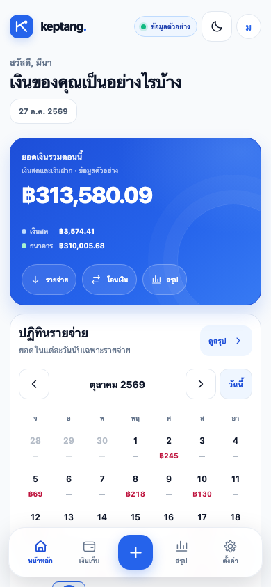
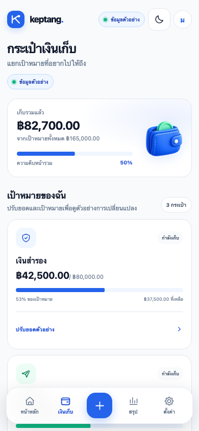
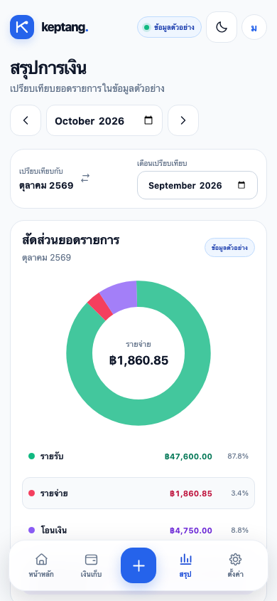

# Hi, I'm Sam 👋

**Thitiwut Wongsa · Full Stack Developer**

I build useful tools for everyday problems. I enjoy turning an idea into something you can try, from web apps and desktop tools to small game experiments.

### A few things I've built

- **[keptang](https://github.com/Muegoo/keptang)** — An expense tracker inside LINE, built with Go, Next.js, and PostgreSQL. Manual entries, categories, and CSV/Excel export are available; slip scanning is planned.
- **[waen](https://github.com/Muegoo/waen)** — A Windows overlay that uses OCR to translate English game text into Thai. Built with Python and PyQt6.

### Keptang mobile preview

Svelte prototype with sample data.

<table>
  <tr><th>Home</th><th>Pockets</th><th>Summary</th></tr>
  <tr>
    <td></td>
    <td></td>
    <td></td>
  </tr>
</table>

### What I work with

Go · Python · TypeScript / JavaScript  
Next.js · FastAPI · PostgreSQL · SQLite · Docker

### Things I'm exploring

[Thai slip and receipt parsing](https://github.com/Muegoo/slip-reader), [AI-assisted workflows](https://github.com/Muegoo/ai-team), and ways to make small, useful products easier to build.

### Say hello

[LinkedIn](https://www.linkedin.com/in/thitiwut-wongsa-439a29385/) · [thitiwut.ws@gmail.com](mailto:thitiwut.ws@gmail.com)
